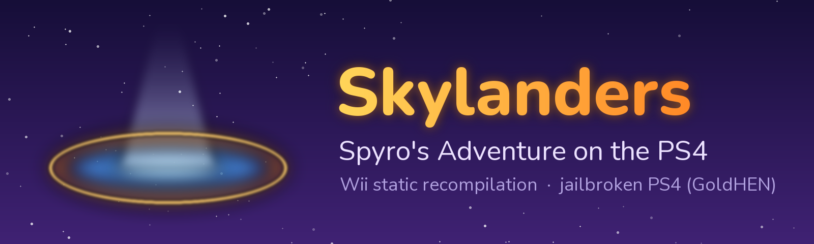

<p align="center">
  
</p>

<p align="center">
  <a href="https://github.com/iHaiDeeZ/Skylanders-PS4/releases/latest"></a>
  
  
  
  <a href="LICENSE"></a>
</p>

<h3 align="center">Skylanders: Spyro's Adventure, running natively on the PS4.</h3>

<p align="center">
  <a href="https://github.com/iHaiDeeZ/Skylanders-PS4/releases/latest"><b>⬇ Get the latest release</b></a> ·
  <a href="#getting-started">Getting started</a> ·
  <a href="#controls">Controls</a> ·
  <a href="#the-quick-menu">Quick menu</a> ·
  <a href="#faq">FAQ</a> ·
  <a href="#thanks">Credits</a>
</p>

---

## Overview

This port runs the Wii version of **Skylanders: Spyro's Adventure** (Toys for Bob, 2011) on jailbroken PS4
consoles, without Dolphin. The game's PowerPC code is translated ahead of time into C++ on a PC and
compiled for the PS4's x86-64 CPU. A runtime written for this game then stands in for the Wii's
hardware: the GX graphics chip drawn through Vulkan (Mesa's RADV, adapted to the PS4's GPU), the DSP's
audio, the disc drive, IOS's file system for saves, Bluetooth with a Wii Remote and Nunchuk, and the
**Portal of Power**, emulated with figure files.

It installs as an app on the home screen and plays with a DualShock 4 as the Wii Remote and Nunchuk.
Holding **L1 L2 L3 + R1 R2 R3** opens a quick menu for the frame counter, aspect ratio, internal
resolution, controls and Wii Remote settings.

**Status: work in progress.** The game boots, loads and plays through its hub world and first levels.
On a base PS4 it showed 16 to 23 fps in the hub world (v00.21), held back by the speed of the game's
own code on one CPU core. A PS4 Pro with **Boost Mode** on runs that core about a third faster.

You bring your own game: nothing copyrighted is in this repository or its releases. No game code, art
or sound. The translated code made from your disc, and any package you build with your disc inside,
contain the game, so never share them.

## Highlights

**The game's own code, natively**
- Every function of the game's main executable (26,214 of them) translated to C++ by
  [Crema](https://github.com/iHaiDeeZ/Crema)'s PowerPC recompiler with a C++ backend, then built with
  clang for the PS4's Jaguar cores: no JIT in the way, an interpreter only for the odd leftover.
- Built with a profile of the game running (profile-guided optimization), and with the compiler's
  register save and restore helpers expanded in place.
- The AXFX reverb, the game's busiest audio routine, runs as native code.

**The Wii in software**
- GX command lists decoded as the game writes them and drawn with Vulkan: TEV shading, indirect
  textures (the movies), EFB copies, destination alpha with dual-source blending.
- Internal resolution up to 3x (1920x1584), 4:3 or 16:9, smooth texture filtering.
- The DSP's AX mixer (32 kHz voices, reverb) played through the PS4 at 48 kHz.
- Saves on an emulated NAND in `/data/SSA/nand`.

**Wii Remote, Nunchuk and the Portal**
- The DualShock 4 is the Wii Remote and Nunchuk, with DolphinPS4's layout. Every button can be rebound.
- The pointer follows the right stick, the DualShock 4's gyro or the touchpad. Motion controls come
  from the controller's sensors, and rumble too.
- A **PS Move** can be the Wii Remote, with its own motion and pointer.
- The Portal of Power is emulated: figures are 1 KB files. Spyro is on it from the first start, and
  the game saves his progress to the file as it would to the toy.

**PS4 Pro**
- With **Boost Mode** (Settings → System) the CPU runs at 2.13 GHz instead of 1.6. The detailed frame
  counter shows the clock, and the app says when Boost Mode is off.

## Getting started

**You need:** a jailbroken PS4 with **GoldHEN** and an FTP connection to it, your **own** disc of
*Skylanders: Spyro's Adventure* for the **Wii**, North American release (**SSPE52**, revision 1),
dumped on your Wii (for example with CleanRip), and a PC with **WSL 2** to make the translated code.
No real Portal of Power is needed.

1. Extract the disc image's data partition with Dolphin's `dolphin-tool`:

   ```bash
   tools/extract-disc.sh your-disc.rvz ~/ssa-disc
   ```

   You get `sys/` (with `main.dol`), `files/` and a few small files: about 4 GB. Its `sys/main.dol` must
   have SHA-1 `161858104eed2fd9e9f76cd692e99ebc7c7fdca8`.

2. Make the translated code, `ssa16.aot`, on the PC ([Building](#building), steps 1 to 4):

   ```bash
   scripts/build-aot.sh ~/ssa-disc ssa16.aot pgo
   ```

3. Copy the folder to the console as **`/data/SSA/disc`** and the translated code as
   **`/data/SSA/ssa16.aot`**, over FTP.

4. Install the release's **`Skylanders-SSA-vXX.YY.pkg`** (title ID `SKYL00001`) with GoldHEN's
   **Package Installer**, then start **Skylanders: Spyro's Adventure** from the home screen.

> **Tip:** `ps4/build.sh` can also make a **one-file package** with your disc and translated code
> inside (`SSA_PKG_FULL=dir`, about 4 GB): nothing to copy to `/data/SSA`. It holds the game, so keep
> it to your own consoles.

**Updating:** install the newer package on top. Your saves, figures and settings stay in `/data/SSA`.

## Controls

The defaults, DolphinPS4's layout. Change them on the quick menu's **Controls** page.

| DualShock 4 | Wii Remote |
|---|---|
| Cross | A |
| R2 | B |
| Square / Triangle | 1 / 2 |
| L1 | − (Minus) |
| OPTIONS | + (Plus) |
| Touchpad click | HOME |
| R3 | Shake (spin) |
| Right stick | Pointer |
| D-pad | D-pad |

| DualShock 4 | Nunchuk |
|---|---|
| Left stick | Stick |
| L1 | C |
| L2 | Z |
| L3 | Shake |

**Hold L1 L2 L3 + R1 R2 R3** to open the quick menu.

With **PS Move** on: Move button = A, T = B, Cross = 1, Circle = 2, Select = −, Start = +, and its motion
and gyro pointer. **Start + Select** recentres the pointer. The DualShock 4 stays the Nunchuk.

## The quick menu

Hold **L1 L2 L3 + R1 R2 R3** while playing: the game pauses and the menu opens over it. Up / Down picks
a row, Left / Right changes it, Cross selects, Circle goes back. Settings marked *next start* take
effect the next time you start the app. Everything is saved in `/data/SSA/settings.ini`.

| Page | Row | Choices |
|---|---|---|
| Main | Resume Game | |
| Main | Frame Counter | Off, FPS, Detailed (thread loads, frame time, CPU clock) |
| Main | Quit Game | Back to the PS4's home screen |
| Graphics | Aspect Ratio | Auto, 4:3, 16:9 |
| Graphics | Game Widescreen | On, Off (*next start*: the game's own 16:9 setting) |
| Graphics | Internal Resolution | 1x (640x528), 2x (1280x1056), 3x (1920x1584) (*next start*) |
| Graphics | Texture Filtering | Game, Smooth |
| Performance | Sound | On, Off |
| Performance | Vertex Fetch Threads | 0 to 3 (*next start*) |
| Performance | Renderer Thread | On, Off (*next start*) |
| Controls | every Wii Remote and Nunchuk input | press Cross, then the new button; Square clears; Reset to Default |
| Wii Remote | Pointer | Stick, DualShock 4 Gyro, Touchpad, Off |
| Wii Remote | Pointer Speed | 1 to 10 |
| Wii Remote | Motion Controls | Off, DualShock 4 |
| Wii Remote | PS Move | Off, On |
| Wii Remote | Rumble | On, Off |
| Wii Remote | Recenter Pointer | |

## Your files

Everything lives in **`/data/SSA`** on the console:

| Path | What it is |
|---|---|
| `disc/` | Your extracted disc (not needed with a one-file package) |
| `ssa16.aot` | The translated code made from your disc (likewise) |
| `nand/` | The emulated NAND: your saves are in `title/00010000/53535045/data` |
| `figures/spyro.sky` | Spyro on the emulated Portal |
| `settings.ini` | The quick menu's settings and your control bindings |
| `env.txt` | Optional switches, one `NAME=value` per line (see `ps4/env-profile.txt`) |
| `ssa.log`, `ssa-prev.log` | This run's log and the one before |

## FAQ

**Why not just Dolphin?**
Dolphin on the PS4 can't keep this game at full speed. Translating the game's code once, ahead of
time, and emulating only the hardware it really uses leaves far less work at run time.

**How fast is it?**
A base PS4 showed 16 to 23 fps in the hub world with v00.21. v00.22's translated code needs about
15% less work per frame on a PC, which hasn't been measured on a console yet. The game's own code on
one core is the limit, so a PS4 Pro in Boost Mode is the fastest way to play it today.

**Can I put other Skylanders on the Portal?**
Yes, with figure dumps (`.sky`, 1 KB). Add them to `env.txt` as
`SSA_PORTAL=/data/SSA/figures/spyro.sky=16,/data/SSA/figures/other.sky` (`path=id` makes a new figure
with that character ID when the file doesn't exist yet). A Portal page in the quick menu is planned.

**Does it work with a real Portal of Power?**
Not yet: the Portal is emulated only.

**Where are my saves?**
In `/data/SSA/nand/title/00010000/53535045/data`, and your figure's progress is in its `.sky` file.
Copy both to keep them.

**Something went wrong. What should I send?**
`/data/SSA/ssa.log` (and `ssa-prev.log`) from the run that failed.

## Good to know

- The game's other regions and revisions aren't supported: the translated code and its addresses
  are for SSPE52, revision 1.
- The first start of the app copies a one-file package's saves, figure and settings into `/data/SSA`
  only when nothing is there yet.
- [`PLAN.md`](PLAN.md) is the development log: how each part was built, measured and fixed.

## Building

**You need:** a PC with **WSL 2** (Ubuntu), clang/LLVM 21 (`clang-21`, `lld-21`, `llvm-21`), Python 3,
and Ubuntu's `libvulkan-dev`, `glslang-tools`, `mesa-vulkan-drivers` and `zlib1g-dev`. Everything
below runs in WSL; [`PLAN.md`](PLAN.md) explains each part in detail.

1. **Crema's source.** The game's code is translated by [Crema](https://github.com/iHaiDeeZ/Crema)'s
   PowerPC recompiler with its C++ backend. This makes the copy this port uses: upstream Cemu at the
   commit in [`patches/BASE.txt`](patches/BASE.txt), with
   [`patches/crema-ssa.patch`](patches/crema-ssa.patch) applied (Crema's PS4 work, the backend, the
   translated-code loader, and this port's `recomp/patch-*.py` scripts already in it):

   ```bash
   scripts/setup-crema.sh                # into ~/ssa-build/crema
   ```

2. **Headers.** Cemu's code includes **Boost 1.89**, **glm** and **fmt 12.1**, all header-only here: put
   their `boost/`, `glm/` and `fmt/` header folders in one folder and point `CREMA_DEPS_INCLUDE` at it.

3. **The PC harness**, which translates the game, runs it on the PC (`SSA_RUN=1`) and checks every
   translated function against the JIT (`JT_AOT_REAL`):

   ```bash
   export CREMA_DEPS_INCLUDE=~/crema-deps VKDEPS=/usr
   recomp/build.sh objects && recomp/build.sh link    # ~/ssa-build/jittest/jittest
   ```

4. **The translated code** from your extracted disc. `pgo` makes the profile-guided build of the
   releases: the game runs for 400 s on the PC first. Without it you get a plain build, sooner and
   about 15% slower:

   ```bash
   scripts/build-aot.sh ~/ssa-disc ssa16.aot pgo
   ```

   It translates the 26,214 functions in `analysis/entries-aot.txt` the way the releases' code was
   made, so the C++ comes out the same as theirs.

5. **The app**, with [ps4-kit](https://github.com/iHaiDeeZ/ps4-kit) and the OpenOrbis toolchain set up
   as ps4-kit's README says (`CREMA_SRC` / `CREMA_DEPS_INCLUDE` if your copies are elsewhere):

   ```bash
   SSA_VERSION=00.23 ps4/build.sh                    # out/Skylanders-SSA-v00.23.pkg
   ```

   With `SSA_PKG_FULL=dir` (a folder with `disc/`, `ssa16.aot` and, optionally, `seed/` holding
   `nand/`, `figures/spyro.sky` and `settings.ini` for the first start) you get the one-file package.

## Thanks

- **[Dolphin](https://github.com/dolphin-emu/dolphin)**: this runtime's GX decoder, DSP HLE, Bluetooth
  and Wii Remote emulation, Wii Remote encryption and the Portal of Power are ports of Dolphin's code.
- **[Cemu](https://github.com/cemu-project/Cemu)**: the PowerPC recompiler and interpreter that Crema
  builds on.
- **[decomp-toolkit](https://github.com/encounter/decomp-toolkit)**: the analysis of the game's
  executable.
- **[OpenOrbis](https://github.com/OpenOrbis/OpenOrbis-PS4-Toolchain)** and **Mesa**'s RADV, through
  [ps4-kit](https://github.com/iHaiDeeZ/ps4-kit).
- **[Dear ImGui](https://github.com/ocornut/imgui)** for the quick menu, and the **Nunito** font
  (SIL Open Font License, `ps4/fonts/OFL-Nunito.txt`).
- **[GoldHEN](https://github.com/GoldHEN/GoldHEN)**, which makes homebrew on the PS4 possible.

## License and disclaimer

The code in this repository is released under the **GNU General Public License v2.0 or later**
([LICENSE](LICENSE)), as most of the runtime is ported from Dolphin's GPL code.
[`patches/crema-ssa.patch`](patches/crema-ssa.patch) changes Cemu's source and stays under Cemu's
license, the **Mozilla Public License 2.0**. The Nunito font is under the SIL Open Font License.

This project isn't affiliated with or endorsed by Activision, Toys for Bob, Nintendo or Sony.
*Skylanders* and *Spyro* are trademarks of their owners. No game files are included: play games you
own.
